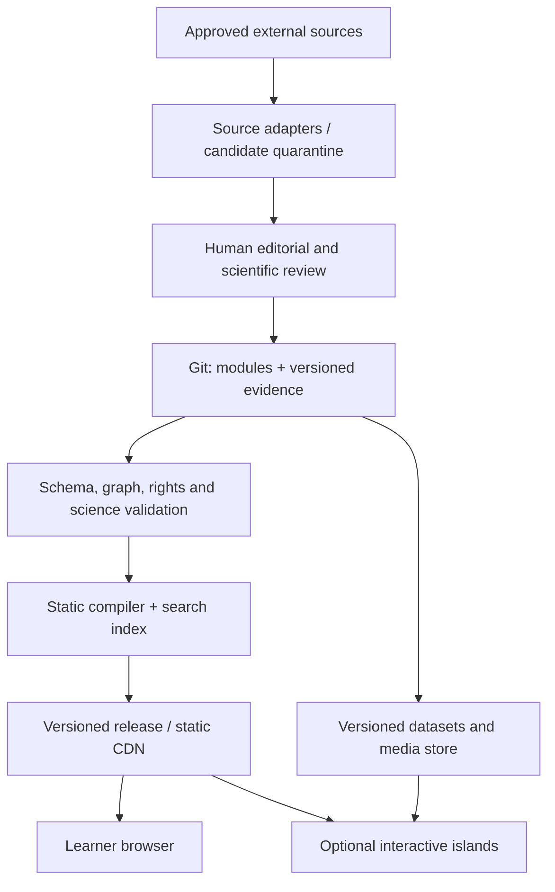
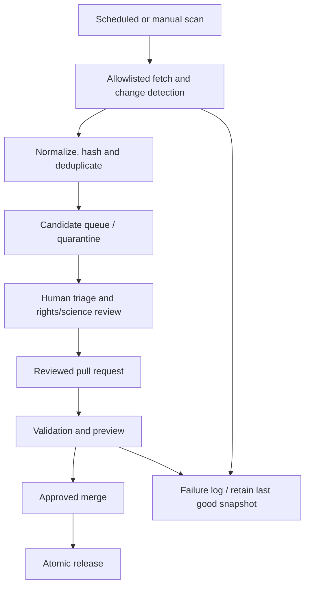

# Universe Learning Platform — System Design v1.1 (OpenCosmos working title)

**Status:** Final engineering handoff baseline, revised November 17, 2026; scientific publication approval remains an independent human responsibility.  
**Purpose:** A public, open-source learning and scientific discovery platform, from first exposure to astronomy to research literacy and reproducible scientific investigation.  
**Scope:** System design, not a deployed or scientifically validated implementation. OpenCosmos is an internal codename only: a space-industry company already operates as Open Cosmos. Do not publish under that name or register branding until the owner has cleared a distinct name. Use neutral internal package names such as `universe-platform`.

## 1. Executive decision

Build one maintainable GitHub monorepo and one public website. Organize the system around a curated, versioned scientific knowledge graph, rather than an encyclopedia made from scraped articles or a collection of unrelated visualizations. Every page, learning path, timeline entry, experiment, and research question must connect to an identifiable scientific subject and traceable evidence.

The first flagship experience is **The History of the Universe**, with a beginner-friendly chronological journey that progressively reveals experimental evidence, mathematical models, observations, open questions, and links to real datasets. It is a vertical slice through the whole architecture, not an isolated microsite.

Long-term breadth is a direction, not a claim of completeness. The platform cannot represent everything that exists, everything beyond our observational horizon, or all unsettled science. Its public coverage map must disclose what is covered, reviewed, planned, outdated, and unknown. A module is never called complete merely because its directory exists.

### Non-negotiable principles

- No LLM-generated scientific text, claims, citations, observations, research gaps, translations, or scientific illustrations, including drafts intended for the knowledge base. Human-authored material or legally reusable original material, reviewed against reliable sources. Coding agents may implement software, non-scientific interface copy and technical fixtures; deterministic automation is permitted for authorized collection, conversion, indexing, validation and publishing only. Never feed restricted sources into a language model.
- Learning is free, accessible, mobile-friendly, and usable without a login or GPU.
- Scientific evidence takes precedence over impressive effects. A simulation, illustration, measurement and hypothesis must be visibly distinguished.
- The source of truth is versioned content and metadata in Git, not a particular website framework, external search engine, or fragile scraper.
- One module can be independently maintained without copying or breaking other modules.
- A failed update never silently corrupts public scientific content.
- Do not imply NASA, ESA, SpaceX or any other institution endorses the project.

## 2. Senior architecture review: where the dream breaks

| Failure mode | Why this happens | Design correction |
|---|---|---|
| Unlimited scope | Every new topic creates several more, with no finish line | Publish explicit module coverage and staged maturity; build a vertical slice first |
| Duplicate facts | Separate beginner, academy, encyclopedia and research directories independently rewrite identical claims | Stable concept and claim IDs; learning paths reference canonical records |
| Permanent Git branches per field | Divergent changes to core schemas, hard merges, abandoned branches | Domain modules on main; short-lived PR branches and domain ownership |
| Tree-only science taxonomy | Black holes, gravitational waves and cosmology are cross-disciplinary | One primary owner plus multi-valued semantic taxonomy and typed relationships |
| False historical precision | Ancient dates have uncertainty, many are inferred, and time scales vary enormously | Explicit time frames, range, precision, evidence status and model |
| Scraped misinformation | Official pages disagree, change or contain context-dependent language | Version provenance, reconcile contradictions, approve scientifically |
| Copyright debt | Publicly readable is not the same as freely redistributable | Asset- and record-level rights; use links/metadata where reuse is not allowed |
| Infinite article backlog | Automated collection overwhelms reviewers | Weekly bounded candidate queue, deduplication, triage and release gating |
| Broken educational sequencing | Attractive pages do not ensure prerequisite knowledge | Prerequisite DAG, learning objectives, exercises and reviewer-approved paths |
| Visuals mislead | Artistic scale, light speed, orbits and physical models can be confused | Separate scale modes, units, legends, assumptions and visual provenance |
| GPU-first website | Low-end phones cannot render huge 3D scenes | Static/2D baseline, optional lazy 3D, memory budget and fallback |
| One bad domain breaks all | Monolithic builds and unvalidated new modules | Manifest contracts, affected-module CI, required global references, atomic releases |
| Live API dependency | Vendor outage or schema change disables every lesson | Pinned approved snapshots, external API isolation and stale labels |
| Scientific revisions erase history | Corrections and retractions need transparent records | Immutable release manifests, supersession, revision trail, claim withdrawal |
| Fake research “gaps” | Lack of a page is mistaken for an unsolved question | Dated source-backed unanswered question, competing explanations and status |
| Maintainer burnout | Founder becomes bottleneck on thousands of scientific edits | CODEOWNERS, delegated reviewers, onboarding, templates and quotas |
| Data bloats Git | Raw FITS, videos and simulation files make clones unusable | Git tracks metadata and bounded examples; immutable external data store |
| Automation security | Malicious markup, fork PRs, remote URLs and supply-chain compromise | Sanitized Markdown, allowlists, secret isolation, pinned actions |
| Careers mislead learners | Eligibility and admissions vary by country and change | Jurisdiction and checked-at dates; point to official programmes; no guarantees |
| Big-bang misconception | A diagram appears to show matter exploding into empty space | Accessible explanatory labels and model-specific limitations |
| Vendor lock-in | Content stored in proprietary CMS or graphical runtime | Plain files, portable JSON Schema, reproducible build, open formats |
| Silent stagnation | Cron jobs fail or are disabled and nobody notices | Freshness monitoring, manual dispatch and status page |

## 3. Product information architecture

Public sections are views over canonical records, not separate knowledge silos:

| Section | Primary experience |
|---|---|
| Start | Choose a learning goal, navigate to reviewed introductions |
| Universe History | Cosmic evolution, Earth and life, astronomy, exploration |
| Academy | Structured lessons from basics through advanced mathematics |
| Explore | Searchable subjects, objects, maps, interactive visualizations |
| Evidence | Measurements, models, source references, debates and uncertainty |
| Research Frontier | Open scientific questions, surveys, reproducible projects |
| Laboratories | Simulations, real datasets, exercises, notebooks |
| Space Technology | Spaceflight, rockets, observatories, instruments, robotics |
| Careers | Scientist, astronaut, engineer, mission operations, citizen science |
| Library | Official publications, manuals, datasets, tools and attribution |
| Community | Contribution guide, coverage map, review process and changelog |

Every individual concept can be reached from multiple sections through its stable ID.

### Initial ownership domains

These are organizational modules, not an authoritative classification of all science. Extend subfields incrementally and cross-reference the Unified Astronomy Thesaurus (UAT), pinned to a particular released version. UAT is licensed CC BY-SA 3.0; a redistributed/adapted taxonomy must remain separately attributed and licensed accordingly. Each module declares one primary owner; subfields can have multiple taxonomy parents.

1. Foundations: mathematics, physics, scales, units, scientific method, coordinate systems.
2. Cosmology: expansion, early universe, CMB, dark matter, dark energy, structure formation.
3. Galaxies and extragalactic astronomy: formation, evolution, clusters, active nuclei.
4. Stars: star formation, stellar evolution, nucleosynthesis, variable stars.
5. Compact objects and high-energy astrophysics: black holes, neutron stars, gravitational waves, cosmic rays.
6. Solar system and planetary science: Sun, planets, moons, asteroids, planetary geology and atmosphere.
7. Exoplanets and astrobiology: detection, habitability, origins and biosignatures.
8. Earth and life: geological history, planetary habitability, atmosphere and biosphere.
9. Observational astronomy: instruments, spectroscopy, surveys, data processing, multi-messenger astronomy.
10. Space engineering and exploration: propulsion, spacecraft, orbital mechanics, communication, robotics.
11. Human spaceflight: mission history, astronaut pathways, human factors and space physiology.
12. History of science, society and space policy: global astronomical traditions, discovery history, governance and ethics.

Cosmic History is a cross-domain experience with its own timeline records and curator; its facts reference the domains above. Research and career paths are likewise cross-domain views. New modules may cover emerging interdisciplinary areas after a domain proposal and review.

### Depth levels (not a ranking of people)

| Level | What a visitor can do |
|---|---|
| L0 | Explain a concept with an everyday analogy or labeled picture |
| L1 | Identify objects, vocabulary, basic cause and effect |
| L2 | Describe mechanisms, evidence, and simple quantities |
| L3 | Apply equations, solve exercises, read an introductory textbook |
| L4 | Analyze real data, reproduce a calculation, understand a paper |
| L5 | Investigate a documented open problem, compare methods and limitations |

Not every concept needs six versions. Each module declares its available levels and prerequisites, and displays missing coverage. A beginning lesson must not require advanced mathematics; the technical route may.

## 4. Target architecture



### Architecture decisions

- **Modular monolith**, a single shared content compiler and website; no premature service mesh, graph database, or separate domain deployments.
- Static-by-default Astro, TypeScript, semantic HTML, CSS/SVG. Use islands for React components only when necessary. Astro's collection schemas validate the shape of local content; the independent domain validator checks semantics across content types.
- Use Pagefind for initial full-text static search, with generated taxonomy facets and paths. Keep the search adapter replaceable. Reference relationships are compiled to indexes; do not require a live graph database at launch.
- Python for narrowly scoped scientific data transformations and documented notebooks; pinned environment and deterministic fixtures. Astropy for astronomy quantities and model-based times, where appropriate.
- JSON Schema as portable canonical metadata contracts. TypeScript types generated or checked against them; Markdown is a presentation format, not an authorization mechanism.
- GitHub Actions for test, review candidates, release and deployment, with independent build/deploy workflows. Deploy only from an approved main-branch snapshot.
- Static hosting/CDN selected for atomic deploys, immutable artifacts and rollback. GitHub Pages is acceptable for a small pilot, but a growing media-heavy release must not rely on its size limits.
- Large external datasets and images may use object storage or upstream scientific archives. An integrity-pinned manifest in Git records rights, size, version and checksums.
- No required database, login, recommendation service, or LLM inference at v1. Add them only with a documented need and explicit threat model.

## 5. Repository contract

```text
opencosmos/
  README.md
  LICENSE
  CONTENT_LICENSE.md
  THIRD_PARTY_NOTICES.md
  CONTRIBUTING.md
  CODE_OF_CONDUCT.md
  SECURITY.md
  GOVERNANCE.md
  CITATION.cff
  CHANGELOG.md
  .github/
    CODEOWNERS
    ISSUE_TEMPLATE/
    workflows/
  docs/
    architecture/
      SYSTEM_DESIGN.md
      adr/
    editorial/
    operations/
    release-notes/
  apps/
    web/
  packages/
    contracts/
    registry/
    compiler/
    ui/
    visualizations/
    search/
  modules/
    foundations/
      module.yaml
      concepts/
      claims/
      lessons/
      exercises/
      datasets/
      visualizations/
      questions/
      assets/
      tests/
    cosmology/
    galaxies/
    stars/
    compact-objects/
    planetary-science/
    exoplanets-astrobiology/
    earth-life/
    observational-astronomy/
    space-engineering/
    human-spaceflight/
    history-society/
  experiences/
    cosmic-history/
      experience.yaml
      events/
      tracks/
      storyboards/
    learning-paths/
    career-paths/
    research-paths/
  registries/
    sources/
    taxonomy/
    reviewers/
    redirects/
  tools/
    ingestion/
    science/
    validation/
    release/
  tests/
    contracts/
    integration/
    fixtures/
    browser/
  release/
    manifests/
```

Only create directories for implemented functionality, or a clear documented module proposal. The tree is a target, not a mandate for hundreds of empty folders. Build outputs are ignored. Each module follows the same contract, not necessarily every folder.

### The branch ambiguity

Scientific branches are modules. Git branches are temporary change sets. Use protected `main` (or equivalent reviewed workflow as supported), plus branches such as `feat/history-v1`, `content/cosmology-cmb`, `fix/planetary-source-2026-11`, and `chore/schema-v2`. Do not maintain permanent `cosmology` and `stars` Git branches.

One module manifest describes module ID, schema version, status, owner, allowed reference types, prerequisite module dependencies, taxonomy mapping, supported locales, and review status. Dependencies must form a DAG at build/package level; a semantic concept graph may legitimately have cycles. If a prerequisite cycle appears, redesign the learning path rather than deleting scientifically meaningful cross-links.

Shared packages cannot import individual domains. The compiler discovers manifests, never requires hard-coded routes for every new field. Every record has one canonical owner. Modules reference external records by stable IDs, not relative paths into another module. Domain owners approve edits to their own content; cross-domain claim changes require both relevant reviewers.

## 6. Canonical data and relationships

| Record | Required data |
|---|---|
| Module | ID, schema version, owner, status, dependencies, taxonomy |
| Concept | ID, title, definitions, taxonomy mappings, aliases, level coverage |
| Claim | ID, concept, exact proposition, evidence links, status, uncertainty, reviewed date, revisions |
| Source | ID, authoritative URL/DOI, author/institution, date, version, retrieval date, rights and checksums if stored |
| Evidence | Claim, source pinpoint, relation (supports/challenges/context), method, limitations, data or observation |
| Lesson | ID, concept links, level, objectives, prerequisites, reviewed content, exercises |
| Dataset | Provider, version, download URL, size, format, rights, checksum, units, data dictionary |
| Visualization | Type, input datasets/claims, assumptions, units, renderer version, credit, fallback |
| History event | ID, temporal frame, time bounds and uncertainty, evidence, linked concepts |
| Research question | Question, context, evidence gap, methods, open data, review date, status |
| Path | Goal, level, ordered lesson IDs, milestones and optional alternatives |
| Career/mission | Institution, region, requirements or mission milestones, official links, checked date |

All records have a persistent opaque ID and schema version. A page slug is editorial and may change; provide redirects. Keep record revision and release version separate from schema version. Do not reuse deleted IDs; mark them deprecated or superseded. A released record must be discoverable by the version that published it.

### Example module manifest (illustrative draft)

```yaml
schema_version: 1
id: cosmology
title: Cosmology
status: draft
owners: []
depends_on: [foundations]
taxonomy_provider: uat
locales: [en]
review_policy: science-and-education
```

Empty owners block publication. Never invent reviewer identities. Register maintainers who consent to be listed.

### Evidence states

Use categories such as well-established, model-dependent, contested, hypothesis, and historical/superseded. Distinguish claim evidence status from record lifecycle: draft, in-review, approved, published, withdrawn. Don't equate one preprint, press release or peer-reviewed paper with consensus. Don't label an assertion a proven fact solely because it comes from an official domain.

One claim may link to competing evidence; keep the history of changes, show methodological limitations, and date scientific assessments. Provenance borrows from W3C PROV concepts (entity, activity, agent, derivation); full RDF implementation is optional later.

### Concept relationships

- `broader_than` / `narrower_than`: taxonomy.
- `related_to`: cross-domain discovery, cycles acceptable.
- `requires`: learning prerequisite, cycles prohibited.
- `has_evidence`: claim to evidence.
- `uses_dataset`: experiment or visual to versioned dataset.
- `investigated_by`: question to mission, instrument or method.
- `supersedes`: version history, acyclic.

## 7. Flagship: evolving scientific history of the observable universe

NASA's cosmic histories are useful initial reference material, but source pages can use different approximations and updated discovery boundaries. The goal is to construct a scientifically maintained timeline, not merely copy one old infographic.

### Tracks

| Track | What belongs there |
|---|---|
| Early cosmic history | Earliest model limits, expansion, particle epochs, nucleosynthesis, recombination |
| Cosmic dawn | Dark ages, first stars, first galaxies, reionization |
| Structure evolution | Galaxies, clusters, stellar generations, chemical enrichment, black holes |
| Solar system | Sun, planet formation, solar-system evolution |
| Earth and biosphere | Earth's geological history, earliest life evidence, biological evolution, humans |
| History of knowledge | Global astronomy, telescope history, scientific theories and discoveries |
| Space exploration | Missions, satellites, observatories, human spaceflight |
| Future scenarios | Separately labeled conditional scientific projections; not known history |

Each track can show different time resolutions and overlap other tracks. Do not portray the first stars as having a known exact birthday. Use NASA and ESA sources for cosmology; geological chronology follows the International Commission on Stratigraphy and relevant scientific evidence; mission events use official mission records.

### Temporal model

Keep four distinct time representations:

1. Cosmic age: time elapsed since the modeled hot early universe.
2. Lookback time: difference between the modeled present age and age at an observation's redshift.
3. Geological age or relative chronology: e.g. millions of years before a stated reference.
4. Human calendar date or timestamp: discovery, launch, publication, observation, or retrieval date. Historical dates may be approximate, intervals, or year-only; do not fabricate a month, day, or timezone.

Store temporal frame, model ID if required, unit, nominal value or lower/upper bound (decimal strings or decimal-safe serialization), precision, uncertainty type, and a source-backed justification. Store human event dates separately. Do not feed cosmic timestamps into JavaScript Date. Do not combine redshift, distance and time without an explicit cosmological model. Astropy provides model-based cosmology functions; pin model and code versions. Preserve uncertainty semantics (measurement interval, confidence level, model range, or unconstrained date), not merely numeric endpoints. Use the original published reference epoch. Never conflate a detection date, emission age, current distance and lookback time. Validate any unit or frame conversion against known reference cases and reject incompatible comparisons. Geological numerical boundaries can change; pin a chart version rather than treating every boundary as exact.

### Example event schema (placeholder, not scientific content)

```yaml
schema_version: 1
id: event.example
track: cosmic-dawn
time:
  frame: cosmic-age
  unit: yr
  lower_bound: null
  upper_bound: null
  model_ref: null
  precision: unknown
  uncertainty_note: Awaiting reviewed evidence.
claim_refs: []
evidence_refs: []
concept_refs: []
status: draft
```

No empty or unreviewed example may appear in public scientific content.

### User experience

At introductory level, guide visitors through an illustrated story with optional narration, visible controls, clear labels and brief explanations. Each event opens an evidence panel, source, mathematical extension, links to related questions and further learning. Use an overview with semantic zoom into epochs; provide a flat accessible list and searchable index. Clearly distinguish logarithmic, linear, compressed schematic, and physically scaled views. Handle zero separately for logarithmic views. Time-range uncertainty should appear as an interval rather than an invented point.

Provide a distinct “How do we know?” view for every era. Teach observational limitations and distinguish observations from reconstructed events. Never imply we can see everything that exists or that time zero is directly observed. Future scenarios require stated assumptions and are not rendered as known history.

## 8. Research Frontier

The unit of research discovery is a specific, answerable or investigable question, linked to a field, not an automatically generated list of gaps. For each question provide:

- What is established and what remains uncertain.
- Dated sources: research papers, review articles, priority reports and relevant missions.
- Evidence gap and limitations, alternative explanations, observation or measurement requirements.
- Required mathematics, physics, computing and skills.
- Reusable datasets, methods, practical starter experiment and appropriate limitations.
- Links to lessons, notebooks and official community resources.
- Status: proposed, active, disputed, partially resolved, resolved, superseded; never declare resolution automatically.

Use community priority reports such as the National Academies' astronomy decadal survey, but do not represent their priorities as exhaustive or universal. Include international sources. Cite preprints as such and record publication/retraction updates.

A beginner research path might be: understand light → read spectra → learn Python data tables → visualize a reviewed public spectrum → reproduce a published method → identify a documented question. No promise that following the path produces a publishable discovery.

## 9. Source ingestion and rights

### Source policy

Prefer versioned official APIs, datasets, persistent archives, structured metadata and open educational works. Examples: NASA Science, NASA Exoplanet Archive, MAST, NASA/JPL mission datasets, ESA archives, CDS, IVOA, NASA ADS, Crossref, astronomy journals and scientific organizations. Evaluate access, reliability, license, rate limits and scope separately for each adapter. Crossref metadata is not a blanket grant to redistribute paper text or abstracts. Publicly accessible PDFs are not presumed open license. OpenStax Astronomy 2e is a link-only reading recommendation by default: its published CC BY-NC-SA 4.0 and additional AI-ingestion restrictions preclude treating it as a freely importable CC BY corpus. Do not ingest its content into AI or automated model workflows without prior written permission.

An approved source record includes URL/domain, provider, permitted retrieval and redistribution modes, attribution, adapter, expected schema, request budget, refresh cadence, and rights review date. Public-domain or openly licensed works can be imported consistent with their terms; otherwise index identifiers, short lawful metadata, and link to the publisher. Do not bypass paywalls, robots policy, authentication, or rate limits. Robots permission alone does not grant copyright permission.

NASA media often has educational-use permission, but third-party material and NASA identifiers have different restrictions. Verify every asset; avoid copying NASA Eyes or proprietary SpaceX interfaces or code. Review source project licenses before reusing any open-source visualization. OpenSpace's official source repository is a possible reference or reuse candidate, but it expressly excludes its data; WorldWide Telescope's web client and WebGL engine have MIT-licensed code, not blanket rights to every image or catalogue. Keep third-party code and media notices, including applicable copyleft obligations. Default recommendation for original code: Apache-2.0, subject to owner approval and compatibility with any existing repository license. Default recommendation for original human-authored content: CC BY 4.0, with separately labeled third-party licenses; keep UAT-derived content's required share-alike terms if reused. Use a per-record rights decision (link-only, metadata-only, permitted redistribution, restricted/noncommercial, or prohibited). Unknown rights block import; do not assign a license to content the project does not own.

### Update pipeline



Adapters use conditional requests (ETag/Last-Modified where supported), provider-specific throttling, bounded retries, backoff and timeouts. Track last success, last scan, checkpoint, errors and source versions. Overlap incremental date windows to catch records edited late. Deduplicate by stable source ID/DOI plus normalized resource identity; content hashes detect revisions, not scientific equivalence. Idempotent reruns must not create duplicate candidates. Unknown fields or changed schema enter quarantine. Never remove scientific content merely because a request returned a transient error or empty result.

Only approved deterministic metadata updates may eventually be auto-merged under tightly defined policy. Scientific prose, new propositions, changed interpretations, educational structure, controversial observations, and all scientific illustrations require human review. Until pilot reliability is established, every content update goes through a PR. No LLM is in the scientific content pipeline. The v0.1 adapter should begin with authorized Crossref bibliographic fields only (exclude abstracts and full-text scraping; use a maintainer-configured query); keep exoplanet TAP integration for a later approved dataset pilot. An absence of approved content must yield an honest empty state, not invented placeholder science.

## 10. Maintenance and release model

| Cadence | Responsibility | Output |
|---|---|---|
| On demand | Correct factual, rights or security problems | Hotfix / withdrawal, changelog |
| Weekly | Source scan, link checks, triage, retraction alerts | Bounded candidate queue and freshness report |
| Monthly | Review priority changes and new content | Approved content release, module changelogs, coverage update |
| Quarterly | Review lesson paths, performance, accessibility and source health | Maintenance release and backlog reprioritization |
| Annually | Reassess taxonomy, scientific priorities, governance and architecture | Versioned strategic roadmap and module proposals |

Do not require a release or new research field each month if no scientifically reviewed material is ready. A source can be checked without being changed. New questions need source evidence, not just calendar-driven quotas.

GitHub documents that scheduled Actions can be delayed and public-repo schedules can be disabled after 60 days without activity. Manual workflow dispatch and monitored freshness are required; later add an independent monitor if the project grows. Batch candidate changes rather than flooding issues or PRs.

Every release manifest records Git commit, schema version, module revisions, reviewed source versions, build tooling version, dataset hashes, source checks, validation outcome and deployment artifact. Use immutable asset URLs and a single versioned release pointer. Retain prior approved releases for rollback; if a claim is legally or scientifically withdrawn, ensure rollback cannot silently restore it to current publication. Keep public correction notices and invalidate affected caches.

## 11. Animation, illustrations and visualization

The visual language is friendly and scientific: original human-designed vector/cartoon guide characters, source-credited images, restrained transitions and user-controlled interactive experiences. A cartoon is an educational explanation, never an observation. No AI-generated scientific illustrations or fictional telescope imagery presented as data. Agents may implement deterministic visualization renderers and decorative UI components; scientific storyboards, input data and physical semantics must be source-backed and human-approved.

| Renderer tier | Use | Fallback |
|---|---|---|
| Static HTML/SVG | Definitions, diagrams, labeled timelines, graphs | Accessible text and alt descriptions |
| CSS/SVG animation | Simple orbit/scale explanations, illustrative stories | Static illustration and transcript |
| 2D canvas | Large interactive point sets, data plots | Reduced-size static chart and data table |
| Optional WebGL/Three.js | 3D scientific scenes, orientation, orbital demos | 2D or static image, clear explanatory text |
| Notebook or calculation | Reproducible experiments, methods | Rendered result, input data and steps |

Use a reusable scene registry with input contract, asset budget, renderer adapter, version, model assumptions, intended learning outcome, accessibility metadata, and approved storyboard. Every visualization must label observational data, processed/composite image, simulation, model output, or artist's impression. Display relevant coordinate frames, scale, units, time speed, image processing and uncertainty. Validate known reference values against appropriate scientific datasets; decorative effects must not alter them.

Load the lesson first, load optional graphics when visible or requested, and lazy-load large assets. Use responsive optimized images, level-of-detail, pixel-density caps, bounded texture caches, and dispose resources on navigation. Handle WebGL context loss, browser incompatibility and insufficient memory. Do not run expensive animation loops in hidden tabs or offscreen sections. Test both keyboard and touch. Provide manual pause, play, restart, reduced-motion mode, static equivalents, no flashing patterns and readable labels. WCAG 2.2 AA is the design target, subject to audit.

### Performance goals (targets, not measured results)

- At the 75th percentile of real visits, target LCP <= 2.5 s, INP <= 200 ms and CLS <= 0.1 where measured.
- Target compressed initial lesson JavaScript below 100 KB, excluding optional on-demand graphics; enforce a route-specific budget in CI.
- Provide usable text and navigation on low-end Android, slow mobile networks, and no WebGL.
- A simulation failure must never prevent navigation, reading or access to evidence.
- Test actual devices, memory use, battery and interaction smoothness before promising frame rates. Use performance telemetry only with privacy-sensitive configuration.

## 12. Internationalization and user access

English first; make translation and localization possible using stable concept IDs and locale-aware variants. Translations link to the exact source record revision. Flag translations outdated when an underlying claim changes. Support Bengali as a future pilot if reviewed translators are available; don't auto-generate scientific translation. Units and scientific notation remain consistent, and symbols are not replaced based on language. Use accessible navigation for screen readers, subtitles/transcripts, and non-color-only status indicators.

No account is needed at launch. Optional local progress can be stored on-device with a reset control; do not collect learner profiles or require tracking. If accounts, analytics or community submissions are introduced later, specify privacy, consent, data deletion, moderation and security before implementation.

Career and astronaut pathways are country-specific, potentially time-sensitive, and not guarantees. Separate general skills from current official eligibility. Record jurisdiction, institution and review date; link to the relevant space agency or programme.

## 13. Threat model and security

- Treat remote sources, HTML, datasets, Markdown, dependency updates and fork PRs as untrusted.
- Sanitize imported markup, reject executable MDX, scripts, unsafe URLs, arbitrary iframes, dangerous SVG and raw HTML. Only reviewed application code may instantiate trusted components via controlled identifiers. MDX is not safe for arbitrary user content.
- Source fetchers cannot accept arbitrary public user URLs. Strict allowlist, redirects revalidated, private/internal addresses blocked, download caps and content-type checks. Prevent SSRF and decompression bombs.
- Run fork PR checks without privileged credentials. Never execute untrusted notebook code with secrets or production access. Separate privileged deployment from external contribution tests.
- Pin third-party Actions to reviewed commit SHAs; lock dependency versions; maintain dependency scanning and least-privilege tokens. Never expose API keys in a browser bundle. Prefer an existing authorized GitHub connector or credential helper, or an expiring fine-grained token scoped to the single repository. Inject credentials securely using the runtime's secret mechanism; never paste tokens into prompts, repository URLs, arguments, logs, commits, or issue/PR descriptions. A token is not permission to modify other repositories or change repository settings. Workflow-writing permissions are only granted if separately necessary.
- Serve CSP, safe framing policy and security headers appropriate for deployment. Render only approved data, avoid client-side injection, and test static outputs.
- Keep rights infringement or scientific error reporting distinct from security vulnerability reporting; publish the contact or repository workflow once established.
- No secret or restricted raw data in the repository. Sensitive information must be removed safely if accidentally committed.

## 14. Reliability, storage, scalability and operations

### Data boundaries

Git stores text, metadata, contracts, small fixtures, and bounded optimized assets. Do not commit huge raw catalogues, FITS collections, 4K videos, simulation checkpoints, or credentials. Original datasets live in authoritative archives or an immutable artifact store with content hashes, provenance, license and a reproducible fetch command. Generated datasets retain the code/version/parameters used to create them.

Build from the approved Git snapshot, not live API calls. Package static site and pinned search index together. A failed fetch or build leaves the last known good release available. An unavailable external laboratory dataset disables only that optional experiment and shows a status message. Internet outages should not make text unreadable once loaded; offline downloadable lessons can be a later enhancement.

### Monitoring and recovery

| Signal | Trigger / response |
|---|---|
| Source heartbeat | Missed expected window → flag stale, investigate |
| Candidate backlog | Exceeds review capacity → lower ingestion volume |
| Schema changes | Reject incompatible updates, repair adapter and replay |
| Broken reference | Block new release for canonical internal links; warn and triage external links |
| Build/deploy failure | Keep previous release, alert and rerun safely |
| Performance regression | Block material budget breaches; inspect route and graphics |
| Withdrawal | Hide affected knowledge, notify, regenerate derived views |
| Repository or artifact loss | Restore pinned repository and releases from independent backup |

Record operational logs without sensitive personal data. Set an initial recovery objective after selecting hosting, and rehearse restoring the previous approved release before launch. Protect release and source registries; document manual emergency deploy. Backup Git, source metadata, and retained artifacts to an independent location appropriate to budget. Verify restore rather than relying on backup existence alone.

### Scale plan

Pilot with a small set of reviewed lessons; generate fixture sets of 1,000 and 10,000 synthetic metadata records for platform-only load tests, never publish those fixtures as science. Track build time, CI cost, index size, data payloads, search latency and graphics memory.

At growth, shard generated indexes and media, cache content compilation by module hash, and deploy immutable static artifacts. Move to a dedicated search service or build-time worker only if measured latency, index size or build throughput requires it. Introduce live API or database only for clearly scoped dynamic features. Keep canonical content in source control.

## 15. Triple verification and release gates

Pass 1 — structural and machine validation:

- JSON Schema, required ownership, unique IDs, allowed statuses, reference integrity, no dangling redirects, prerequisite cycles, unit/temporal contract checks, rights fields, missing claim sources.
- Module-only tests plus an affected dependency build; full integrated validation before main release.
- Validate source adapter fixtures, retry behavior, schema drift, idempotency and deduplication. External link failure is triaged; never silently accept newly unverified science.

Pass 2 — scientific and educational validation:

- Qualified subject reviewer examines meaning, uncertainty, claims, sources, and competing interpretations.
- Educator/editor examines learning objectives, prerequisites, age-appropriate explanation, misconceptions, illustrations and accessibility. Ideally independent; if only the founder is available, label content draft rather than claim independent review.
- For computational materials, run reproducible reference tests with physically appropriate units, documented tolerances and source-backed expected results. A software unit test does not prove a scientific model.
- Verify rights, attributions and translations. Require correction of all blocking issues.

Pass 3 — delivery verification:

- End-to-end tests for search, links, levels, timelines, navigation, viewport sizes, keyboard and reduced motion.
- Test no-JS where practical, no-WebGL, context loss, slow network, absent dataset, failed ingestion, failed build, and rollback.
- Dependency/security scans and visual regression checks. Manual phone and accessibility testing in addition to automated checks.
- Generate preview for final approval, compare content diff, promote same validated artifact, verify production smoke tests.

Release acceptance: zero unresolved structural blockers, no public unreviewed claims, all published assets have recorded rights and credit, fallbacks work, corrections can propagate, and current release can be recovered. Tests are planned here, not executed on a yet-unbuilt platform. A review record must reference an actual human review and exactly match the approved record revision/hash, with role, decision, date and evidence; only maintainer-protected review metadata counts. Merely inserting a YAML value of `approved` is not approval. Revoke or invalidate review when dependent claims, data, licensing or scientific content change. An agent must never self-approve scientific records or impersonate a reviewer.

## 16. Contributor workflow and module extension

1. Submit a module proposal: user need, scope, overlap, primary owner, taxonomy, credible sources, review capacity, proposed minimum content, dependencies and exclusions.
2. Add module manifest and a small set of records using templates. Start all records in draft. Don't create hundreds of empty articles.
3. Map cross-domain concepts to existing stable IDs. Propose new taxonomy definitions only when justified.
4. Run module validator locally; CI builds changed domain and dependents. Obtain scientific and editorial review.
5. Merge to main after approved PR, generate route and index from manifest, publish only approved records.
6. Assign maintenance cadence, track stale records, add credits/changelog, and reassess coverage quarterly.

### Governance

Founder is initial engineering maintainer and product owner; recruit domain reviewers (astronomers, educators, students under appropriate supervision), data maintainers, accessibility reviewers, and illustrators. Avoid implying founder's AI engineering skills substitute for all scientific expertise. Architecture changes use ADRs (decision, context, alternatives, consequences). Core schema changes need migration scripts and compatibility tests. Contribution and issue templates support content proposals, factual corrections, visualization, dataset, bugs, and research question review.

An editorial board may evolve; publication must be honest about reviewer credentials and coverage. Measure contribution quality and review turnaround, not artificial commit counts. Use small meaningful commits.

## 17. Initial 30-day implementation plan

Dates are targets dependent on review availability. Do not publish scientific material until reviewed.

| Week | Deliverable | Exit condition |
|---|---|---|
| 1 | Git repo, README, license decisions, governance, architecture ADRs, schema v1, modules/foundations and cosmology skeleton, history experience, CI | One module manifest and sample draft validate; tests reject broken references |
| 2 | Static Astro shell, search, source/claim/evidence panels, initial human-authored sourced lessons | First reviewed concepts can be discovered from multiple paths |
| 3 | Cosmic timeline with 3–5 reviewed event groups, original SVG/cartoon storyboard, one interactive science visual, fallbacks | Full beginner story and evidence route work on mobile |
| 4 | One allowlisted ingestion adapter, review queue, release manifest, accessibility/performance checks, deployment and rollback rehearsal | First public preview can be released if all gates pass |

Suggested first lessons: What is the observable universe? How light carries information; how astronomers know the universe is evolving. First timeline groups: early universe, recombination and observable evidence, cosmic dawn, structure growth, Solar System to present. These are editorial topics, not preapproved scientific text. Use primary or approved instructional sources. Only implement actual pages with verified claims.

### Subsequent phases

- Months 2–3: expand astronomy foundations and cosmic timelines, integrate structured datasets, improve beginner paths and contributor tooling.
- Months 4–6: add planetary science, stars, galaxies and observational astronomy according to reviewer capacity; launch initial research paths.
- Months 7–12: expand engineering/careers, advanced notebooks, translations, science visualization toolkit and new modules based on demand.
- Year 2 onward: deepen the frontier catalogue, refine source adapters, partnerships, domain maintainers, and sustained release/archival systems.

No deadline is a guarantee of comprehensive scientific coverage. A good year-one platform can be small but accurate and extensible.

## 18. Architecture decision checklist before coding

- [ ] Replace the internal OpenCosmos codename with an owner-approved distinct name before public branding; repository ownership and name availability confirmed.
- [ ] Code/content/third-party licenses reviewed.
- [ ] Schema and namespace versioning rules accepted.
- [ ] Source registry policy and no-LLM-content rule accepted.
- [ ] Cosmic time model and evidence categories accepted.
- [ ] Initial maintainers and reviewers identified or draft-only status established.
- [ ] Host, backup, release and monitoring approach selected.
- [ ] Accessibility/performance budgets agreed.
- [ ] First vertical slice scope locked; avoid feature creep until validated.

## 19. Reference register — research and engineering sources

These are authoritative starting points and technical documentation, not pre-approved blanket content imports. Consult current terms and preserve exact rights/versions per record.

- [NASA: cosmic timeline](https://science.nasa.gov/asset/webb/first-stars-timeline-of-the-universe/) and [early-universe science](https://science.nasa.gov/mission/webb/early-universe/).
- [NASA: first stars and uncertainty](https://science.nasa.gov/mission/webb/science-overview/science-explainers/what-were-the-first-stars-like/).
- [NASA: universe overview](https://science.nasa.gov/universe/overview/).
- [ESA Planck mission](https://www.esa.int/Science_Exploration/Space_Science/Planck).
- [International Commission on Stratigraphy](https://stratigraphy.org/chart).
- [Astropy cosmology FLRW time and distance methods](https://docs.astropy.org/en/stable/api/astropy.cosmology.FLRW.html).
- [Unified Astronomy Thesaurus](https://astrothesaurus.org/) and [UAT source repository](https://github.com/astrothesaurus/UAT).
- [National Academies: astronomy and astrophysics decadal survey](https://nap.nationalacademies.org/catalog/26141/pathways-to-discovery-in-astronomy-and-astrophysics-for-the-2020s).
- [NASA Exoplanet Archive](https://exoplanetarchive.ipac.caltech.edu/), [MAST](https://archive.stsci.edu/), [NASA ADS](https://ui.adsabs.harvard.edu/).
- [IVOA standards](https://www.ivoa.net/documents/), [Crossref REST API](https://www.crossref.org/documentation/retrieve-metadata/rest-api/).
- [OpenStax Astronomy 2e licensing and AI-use restrictions](https://openstax.org/books/astronomy-2e/pages/preface) — link only by default; [astroEDU](https://astroedu.iau.org/).
- [NASA images and media use](https://www.nasa.gov/nasa-brand-center/images-and-media/).
- [W3C PROV overview](https://www.w3.org/TR/prov-overview/).
- [Astro content collections](https://docs.astro.build/en/guides/content-collections/) and [islands architecture](https://docs.astro.build/en/concepts/islands/).
- [Pagefind documentation](https://pagefind.app/docs/).
- [GitHub Actions event scheduling](https://docs.github.com/en/actions/reference/workflows-and-actions/events-that-trigger-workflows).
- [GitHub Actions secure use](https://docs.github.com/en/actions/reference/security/secure-use) and [secure API credentials](https://docs.github.com/en/rest/authentication/keeping-your-api-credentials-secure).
- [GitHub Pages limits](https://docs.github.com/en/pages/getting-started-with-github-pages/github-pages-limits).
- [W3C WCAG 2.2](https://www.w3.org/TR/WCAG22/).
- [Core Web Vitals](https://web.dev/articles/vitals).
- [HTTP conditional requests](https://developer.mozilla.org/en-US/docs/Web/HTTP/Guides/Conditional_requests).
- [MDX security guidance](https://mdxjs.com/docs/getting-started/).
- [OWASP SSRF prevention](https://cheatsheetseries.owasp.org/cheatsheets/Server_Side_Request_Forgery_Prevention_Cheat_Sheet.html).
- [OpenSpace source and license](https://github.com/OpenSpace/OpenSpace), [NASA Eyes](https://science.nasa.gov/eyes/), [WorldWide Telescope web engine](https://github.com/WorldWideTelescope/wwt-webgl-engine) — visualization references; assess terms and data rights before reuse.
- [Open Cosmos existing company](https://open-cosmos.com/) — working-title collision, not an affiliation.
- [Crossref metadata reuse and abstract exception](https://www.crossref.org/documentation/retrieve-metadata/).
- [NASA Exoplanet Archive TAP](https://exoplanetarchive.ipac.caltech.edu/docs/TAP/usingTAP.html) and [acknowledgment requirements](https://exoplanetarchive.ipac.caltech.edu/docs/acknowledge.html).
- [ICS 2026/06 chart update](https://stratigraphy.org/news/156) — evidence that geological numerical ages and precision change.

### Final audit decisions, November 17, 2026

| Check | Finding | Required implementation consequence |
|---|---|---|
| Name | Existing Open Cosmos company and GitHub namespace | No public branding until distinct name approved |
| Scientific chronology | NASA overview and early-universe pages use different approximations/discovery limits; earliest star formation remains uncertain | Store intervals, source revision and model; never invent an exact first-star date |
| Geological chronology | ICS chart updates numerical ages and precision | Version the chart and preserve uncertainty |
| External taxonomy | UAT CC BY-SA 3.0 | Separate imported taxonomy license and attribution |
| Educational resources | OpenStax Astronomy 2e CC BY-NC-SA and AI-use restriction | Link-only by default; do not ingest its text |
| Open visualization | OpenSpace repository excludes data; WWT engine code is MIT | Separate code and dataset license audits; no wholesale copying |
| Research metadata | Crossref exceptions include copyrighted abstracts | Allowlist metadata fields; keep abstracts out |
| Dataset access | Exoplanet Archive is transitioning tables to TAP | Use documented endpoints and acknowledgment; pin table and query |
| Repository credentials | GitHub recommends least-privilege, fine-grained access | Use secret mechanism, no raw credentials in prompts |
| GitHub automation | Scheduled workflows can be delayed or disabled | Monitor actual freshness and support manual fallback |
| Publication | Agent cannot provide independent scientific review | Draft-only infrastructure release until genuine reviewers approve content |

## 20. Implementation contract and test matrix

The companion `OpenCosmos_AGENT_PROMPT.md` defines the ordered implementation workflow. If an older design statement conflicts with this audit, use the stricter security, rights, accuracy, and publication rule.

### Required local commands (names are contract, implementation may choose a documented package manager)

| Command | Accepted behavior |
|---|---|
| `dev` | Serve the local prototype without secrets or live APIs |
| `validate` | Validate schemas, references, lifecycle, rights, review hashes and temporal constraints |
| `test` | Unit/integration tests including deliberately invalid records |
| `build` | Deterministically build static artifact from tracked approved records and pinned assets; no live source requests |
| `test:e2e` | Browser tests for navigation, search, timeline and fallbacks |
| `ingest:dry-run` | Run bounded fixture-based adapter with no writes; controlled network mode optional |

Publish only the approved registry projection, not the entire repository. Drafts, candidate files, fixtures, restricted payloads and unapproved media must never enter static output or search index. An engineering preview can still demonstrate empty states and synthetic data visibly labeled as non-scientific; it must not be publicly mistaken for an authoritative educational release.

### Failure-oriented test cases

| Test | Expected result |
|---|---|
| Unknown rights, revoked evidence, stale review hash | Block affected scientific publication |
| Missing source ID or cross-domain reference | Fail registry compilation |
| Prerequisite cycle | Fail path compilation; allow semantic related-to cycles |
| Wrong time frame or incompatible unit | Reject conversion |
| Unknown event time | Show unknown, never zero or fabricated date |
| Dates expressed at different precisions | Preserve precision and avoid invalid ordering |
| Duplicate source DOI and changed record | Deterministically deduplicate/flag revision |
| API timeout, rate limit, malformed response | Retain last good snapshot, report stale or quarantine |
| HTML/MDX injection, unsafe redirects and SVG | Disallow executable content and unsafe destinations |
| WebGL context lost, reduced motion, no JS | Maintain readable text and usable static alternatives |
| Unreviewed/deprecated articles | Excluded from public search and public routes |
| Failed build/deploy | Prior approved deployment stays available |
| Withdrawal and rollback | No revoked content restored to active public release |
| Fork PR | No production secrets, no deployment privileges |
| Browser viewport 320–1440 px | No blocking overflow; usable keyboard/touch navigation |

### Version 0.1 boundary

Engineering can ship a functional local and PR-preview shell, validated module manifests, evidence/claim schemas, a history renderer, library links, a search index of eligible records, a bounded metadata adapter and CI even while there are zero approved scientific lessons. A public science release is a separate gate. No claim of full universe coverage, verified astronomical expertise, production uptime, security certification, accessibility conformance, or research novelty may be made before appropriate evidence exists.

## 21. Final position

OpenCosmos should become a growing public scientific learning infrastructure, not simply a website with beautiful space pictures. The defensible unit of progress is a reviewed, accessible concept connected to evidence, a reproducible experience, or a clear scientific question. Start with the flagship history experience and its supporting contracts. Preserve modular independence, reviewability, and scientific integrity even when the platform reaches thousands of pages.
